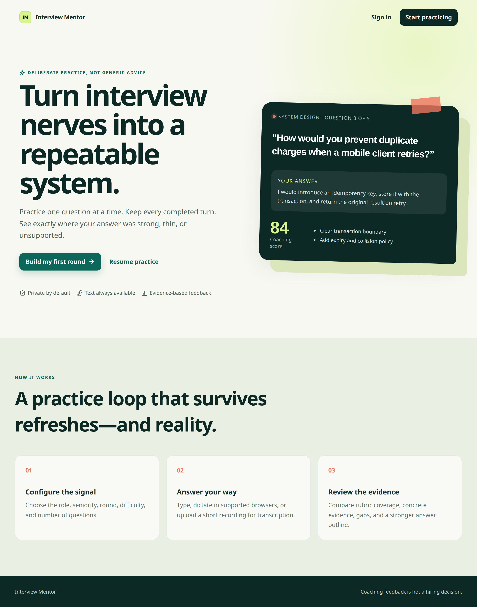

# Interview Mentor

Interview Mentor is a private interview-practice platform for candidates. It runs structured technical, behavioral, system-design, mixed, and custom rounds; stores completed turns durably; accepts text for everyone and voice as an enhancement; and produces evidence-based coaching reports. It is **not** an automated hiring-decision system.



## What changed

The original prototype was one in-memory FastAPI file plus several duplicate React experiments. The rebuild is a modular monolith with a stateless API, PostgreSQL source of truth, Redis-backed work queue/rate-limit seam, a worker, versioned AI contracts, opaque cookie sessions, an accessible TypeScript frontend, migrations, tests, CI, containers, and operating documentation.

### Feature status

| Area | Status |
| --- | --- |
| Registration, login/logout, generic recovery request | Complete |
| Candidate profile | Complete; resume upload waits for object storage and malware scanning |
| Durable text interviews, five round types, reconnect | Complete |
| Idempotent answer submission and server state machine | Complete |
| Per-answer evaluation, aggregate report, history/delete | Complete |
| Browser dictation + MediaRecorder/STT fallback | Complete; raw audio is not retained |
| Server TTS artifacts | Adapter/API seam only; generation remains Phase 3 |
| Quiz and vetted resources | Explicit Phase 2 routes; not falsely presented as functional |
| Job discovery | Deferred and feature-flagged until an authorized data source exists |

## Architecture

```text
React static app ──HTTPS/cookie+CSRF──> FastAPI replicas ──> PostgreSQL
                                              │                 source of truth
                                              ├──> Redis queue/rate metadata
                                              ├──> Worker ──> AI/STT adapters
                                              └──> S3-compatible storage seam
```

The deterministic fake AI/STT provider is the default for local development and tests. Groq is a replaceable adapter, selected only by configuration. See [system architecture](docs/architecture/system.md), [ADRs](docs/adr/README.md), and the [current-state audit](docs/audit.md).

## One-command local stack

Prerequisites: Docker with Compose v2.

```bash
cp .env.example .env
docker compose up --build
```

Open `http://localhost:3000`. The API is at `http://localhost:8000`, OpenAPI at `/docs`, PostgreSQL at `localhost:5432`, and Redis at `localhost:6379`. Local Compose uses the fake provider unless `AI_PROVIDER=groq` and a newly issued `GROQ_API_KEY` are supplied.

Migrations run once in the Compose `migrate` service before API/worker startup. Do not configure every production replica to migrate independently.

### Fast development

```bash
cd Backend
uv sync --frozen
uv run alembic upgrade head
uv run uvicorn app.main:app --reload --port 8000
```

The backend defaults to a local SQLite file only for the fast developer loop; Docker and production use PostgreSQL.

```bash
cd Frontend
npm ci
VITE_API_BASE_URL=http://localhost:8000 npm run dev
```

Set `FRONTEND_ORIGIN=http://localhost:5173` for that API process.

## Environment

| Variable | Purpose |
| --- | --- |
| `APP_ENV` | `development`, `test`, or `production`; production enables strict validation |
| `DATABASE_URL` | Async PostgreSQL URL; Render URLs are normalized to the `asyncpg` driver |
| `REDIS_URL` | Rate-limit/job metadata and worker queue |
| `FRONTEND_ORIGIN` | One exact allowed browser origin; never `*` with credentials |
| `COOKIE_SECURE` | Must be `true` in production |
| `COOKIE_SAMESITE` | `lax` for same-site deployments; `none` with Secure cookies for separate Render hostnames |
| `SESSION_TTL_HOURS` | Opaque session lifetime |
| `AI_PROVIDER` | `fake` or `groq` |
| `GROQ_API_KEY` | Provider credential; required only for `groq` |
| `GROQ_MODEL` | Configurable chat model |
| `EVALUATION_DISPATCH` | `inline` for tests/quick dev, `redis` for deployed worker execution |
| `UPLOAD_MAX_BYTES` | Hard audio upload limit |
| `RAW_AUDIO_RETENTION_HOURS` | Defaults to `0`; raw recordings are deleted after transcription |
| `VITE_API_BASE_URL` | Browser-visible API origin baked into the static build |

Use [.env.example](.env.example) as the names-only template. Never commit `.env` files.

## Quality gates

```bash
cd Backend
uv run ruff format --check app tests
uv run ruff check app tests
uv run mypy app
uv run pytest -q
```

The current backend suite has 27 passing tests and 88.92% branch-aware coverage across interview/auth/security domain services.

```bash
cd Frontend
npm run lint
npm test
npm run build
npm audit
```

The current frontend has 4 passing component/client tests, a passing TypeScript production build, and zero npm audit findings. Browser E2E is in `Frontend/e2e`; CI runs Chromium against the fake-provider stack.

Validate migrations from an empty database:

```bash
cd Backend
uv run alembic upgrade head
uv run alembic downgrade base
uv run alembic upgrade head
```

## Production deployment

The default path is Render: static frontend, Docker API, Docker worker, managed PostgreSQL, and Render Key Value. Review [render.yaml](render.yaml) and [deployment.md](docs/deployment.md), set the two `sync: false` origins/credential values, then validate the Blueprint:

```bash
render blueprints validate render.yaml
```

The API respects Render's `PORT`; migrations are a pre-deploy command. Smoke, rollback, backup, and restore steps are in the [operations runbook](docs/runbooks/operations.md).

## Security action required by the owner

The original `Backend/.env` was committed in the first public revision. Its provider and signing credentials are compromised even though the file is removed now. Rotate/revoke them immediately, review provider usage, and invalidate old sessions. A coordinated optional `git-filter-repo` procedure is documented in [history-cleanup.md](docs/security/history-cleanup.md); this rebuild intentionally does not force-rewrite shared history.

## Further documentation

- [Audit and migration notes](docs/audit.md)
- [Per-phase implementation report](docs/phase-reports.md)
- [C4, sequences, and ER model](docs/architecture/system.md)
- [Architecture decisions](docs/adr/README.md)
- [Capacity and scaling](docs/capacity.md)
- [Threat model](docs/security/threat-model.md)
- [Privacy and retention](docs/security/privacy.md)
- [Deployment](docs/deployment.md)
- [Operations and incident runbooks](docs/runbooks/operations.md)
- [Load test](docs/load-testing.md)
