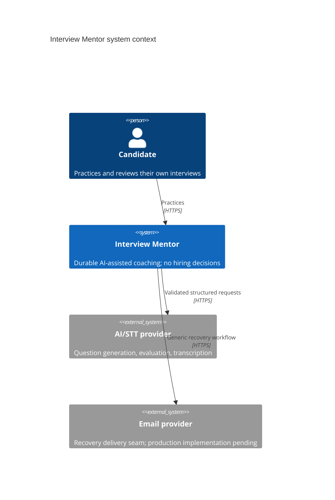
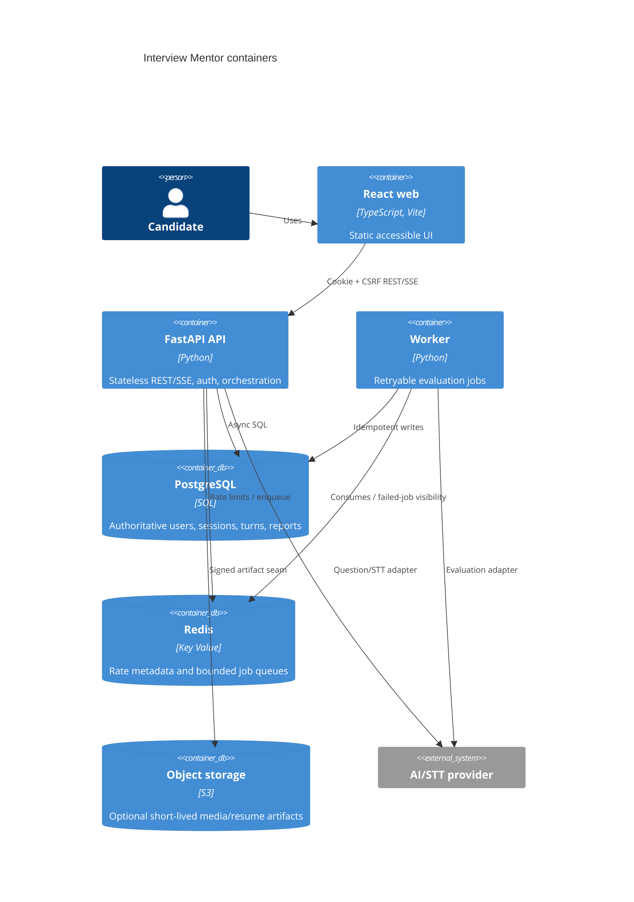
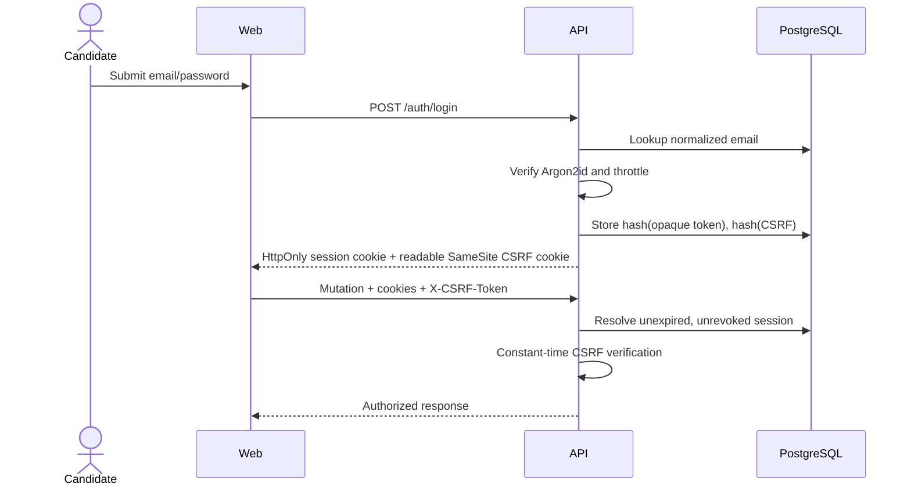
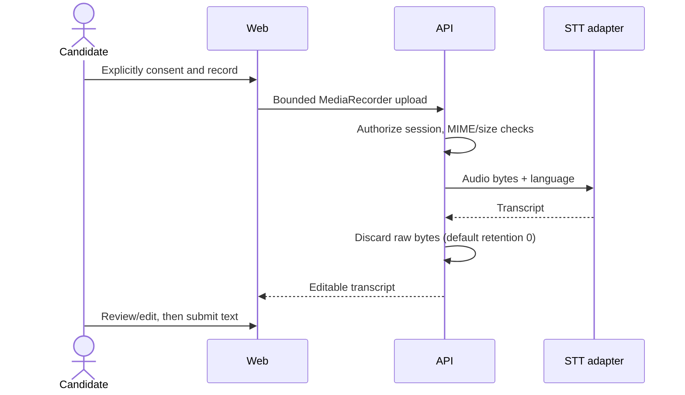
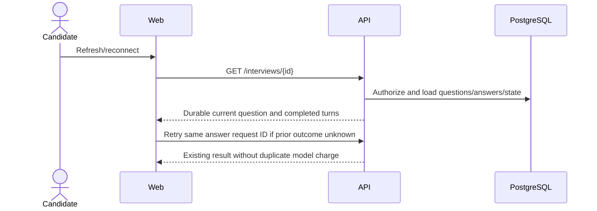
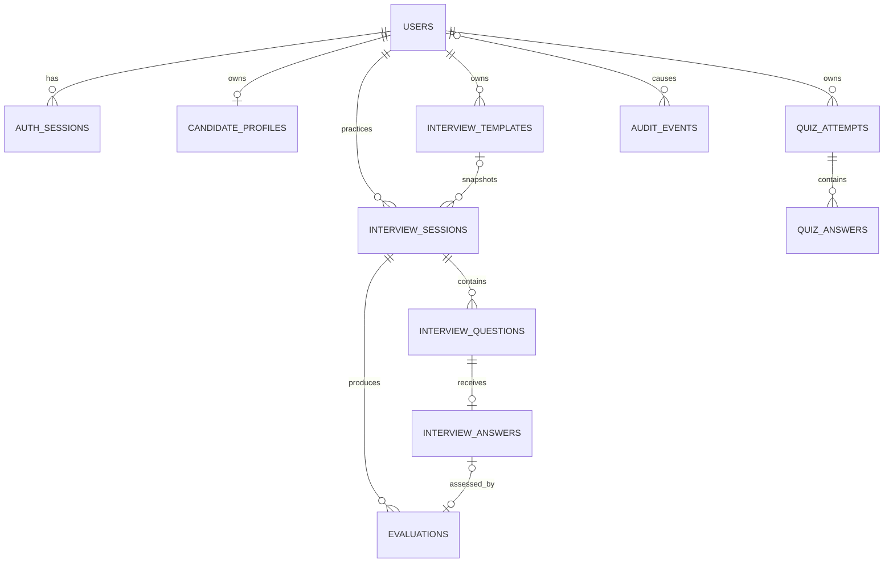

# System architecture

## Context



## Containers



The API is stateless between requests. PostgreSQL is authoritative; Redis loss can delay jobs or degrade distributed rate limiting but cannot erase a completed answer.

## Authentication sequence



## Answer to next question

```mermaid
sequenceDiagram
  participant W as Web
  participant A as API
  participant D as PostgreSQL
  participant P as AI adapter
  W->>A: POST answer + client_request_id
  A->>D: Lock owned session row
  A->>D: Check unique(session, request_id)
  alt duplicate
    A-->>W: Rehydrate current durable state
  else accepted
    A->>D: Validate ACTIVE/current question; insert answer
    alt more questions
      A->>P: Generate one validated question
      A->>D: Insert unique(session, sequence), advance counter
    else final answer
      A->>D: Transition ACTIVE → EVALUATING
      A->>A: Enqueue durable identifiers
    end
    A-->>W: Current session state
  end
```

## Voice transcription



## Async evaluation and reconnect

```mermaid
sequenceDiagram
  participant A as API
  participant R as Redis
  participant K as Worker
  participant P as AI adapter
  participant D as PostgreSQL
  A->>D: Commit EVALUATING + final answer
  A->>R: Enqueue session ID
  K->>R: BRPOP job
  K->>D: Load durable turns; skip completed jobs
  K->>P: Validate each structured evaluation
  K->>D: Store answer/aggregate evaluations; COMPLETED
  Note over K,R: Bounded retry, then failed-job list and FAILED state
```



## Entity relationships



Critical constraints include normalized unique email, unique optional username, unique `(session_id, sequence)` questions, unique question answers, unique `(session_id, client_request_id)` idempotency, bounded score/confidence checks, and user/created-time indexes for history. User ownership is included in every session lookup to prevent horizontal access.

## Extraction seams

Keep the modular monolith until measured load justifies change. The first candidates for extraction are evaluation orchestration (provider quotas), media/transcription (bandwidth/CPU), and interview orchestration (only if lock contention becomes measurable). Kafka and Kubernetes are deliberately absent.
